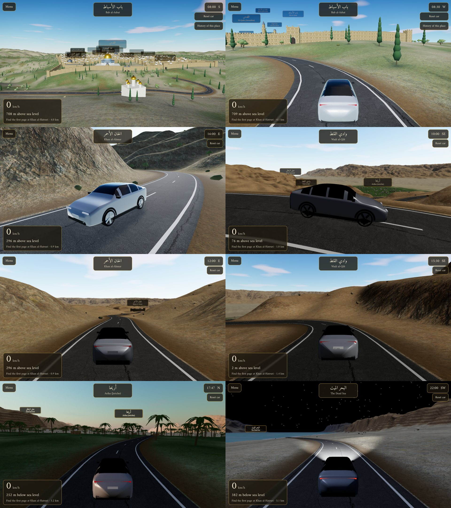

# Rihla: Roads Without Borders

An educational 3D driving game for children and adults. Players travel the roads of
historical Palestine, Jordan, Lebanon and Egypt in the late Ottoman era (around 1910),
learning the landscape, cities, history and Islamic heritage of the region.

**Current state: realism pass R1.** A present-day drive from Al-Quds down to Ariha and the Dead Sea on real
terrain, with photographic ground and stone, a modern road and car, sound, a story opening, the first
journal page, and the history of the Dome of the Rock through time.



- Game brief: [docs/GAME_BRIEF.md](docs/GAME_BRIEF.md)
- Technical design: [DESIGN.md](DESIGN.md)
- Progress and open questions: [docs/PROGRESS.md](docs/PROGRESS.md)
- Facts awaiting review: [NEEDS_REVIEW.md](NEEDS_REVIEW.md)
- Assets and licences: [ASSETS.md](ASSETS.md)

## Play it

You need [Node.js](https://nodejs.org) 22 or newer.

```bash
npm install
```

```bash
npm run dev
```

Then open the address it prints (normally http://localhost:5173).

To make one self-contained file that opens by double-click, with no server:

```bash
npm run build:single
```

The file is `dist-single/index.html`.

## Controls

| Action | Keyboard | Gamepad |
|---|---|---|
| Accelerate, brake and reverse | Up/Down arrows or W/S | Right and left triggers |
| Steer | Left/Right arrows or A/D | Left stick |
| Handbrake | Space | A |
| Change camera | C | |
| Reset the car | R, or the Reset car button | |
| Horn | H | |
| Journal (once a page is found) | J | |
| History of this place (near a site that has one) | the button on screen | |
| Move the clock an hour | [ and ] | |
| Menu | Esc | |
| Performance details | F3 | |
| Autopilot / free camera / place names (for review) | P / F / N | |

On a phone or tablet, on-screen buttons appear.

## Other commands

| Command | What it does |
|---|---|
| `npm test` | Drives the whole road with the autopilot, without graphics, and checks the car arrives |
| `npm run terrain` | Rebuilds the terrain and road from real elevation data (needs internet) |
| `npm run build` | Production build in `dist/` |
| `npm run shots` | Screenshots at several places and times (needs the dev server running, and Playwright) |
| `node tests/play.mjs` | Plays the single-file build: drive, menu, Arabic, performance test |
